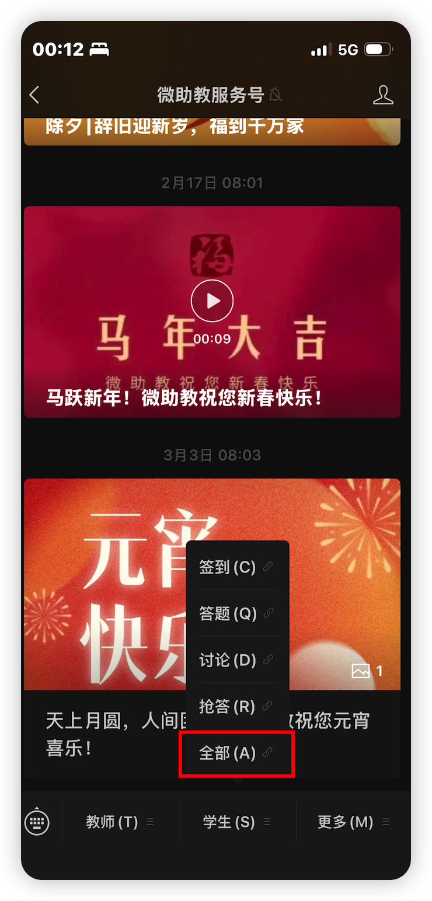
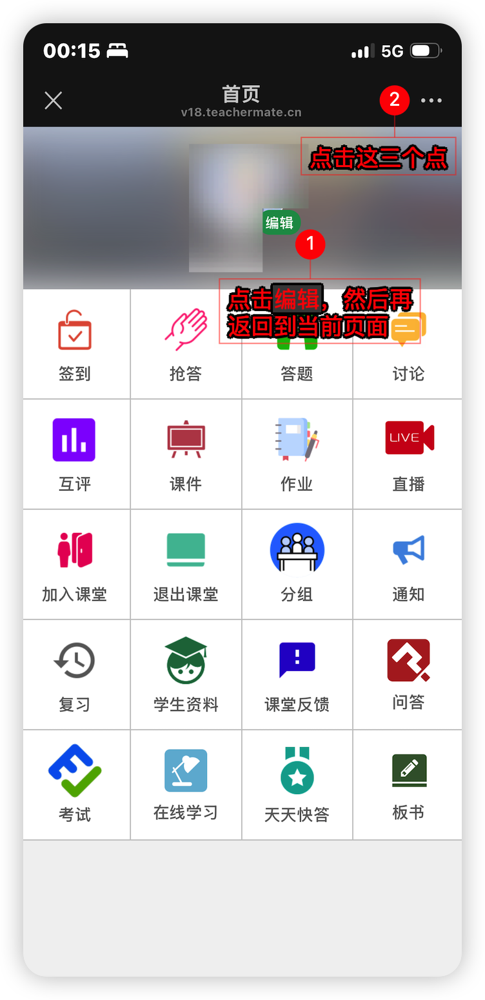
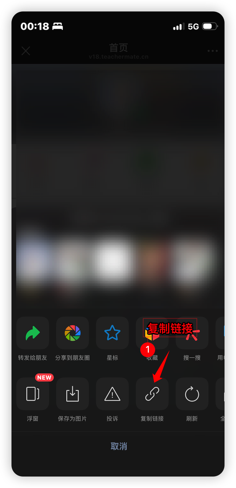
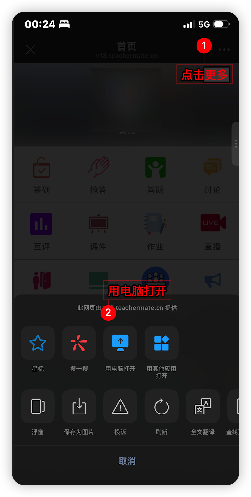
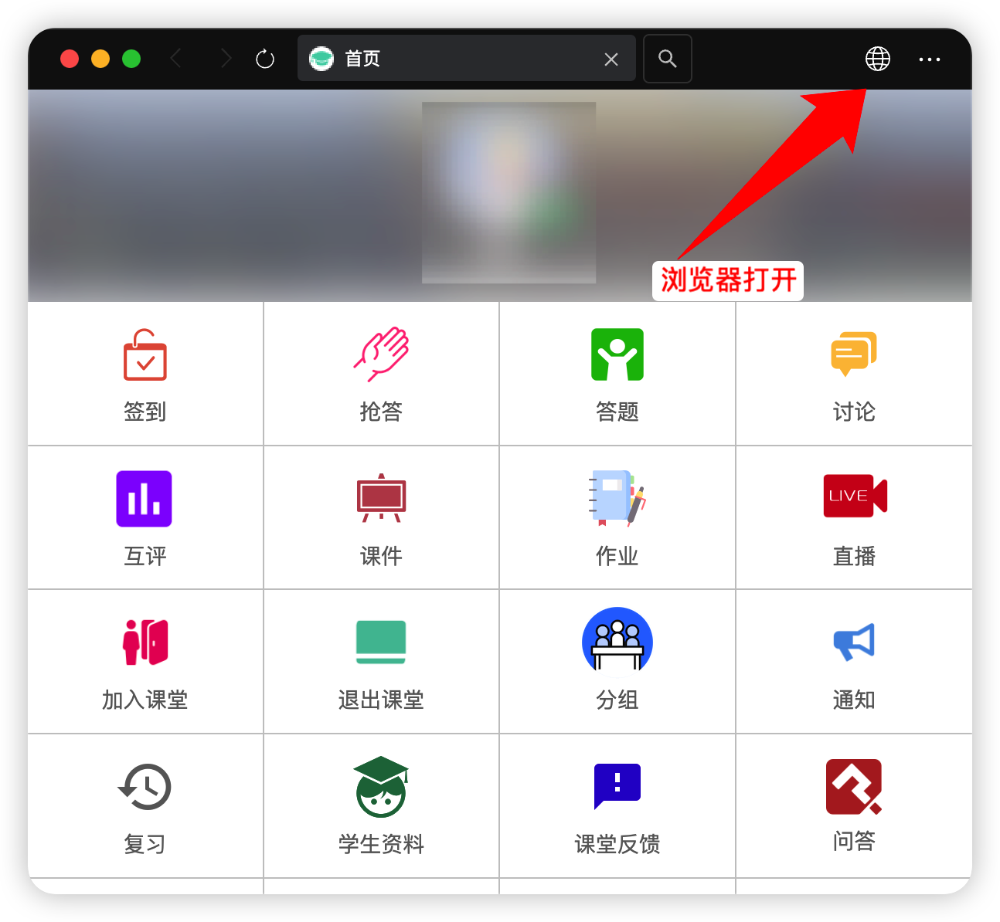
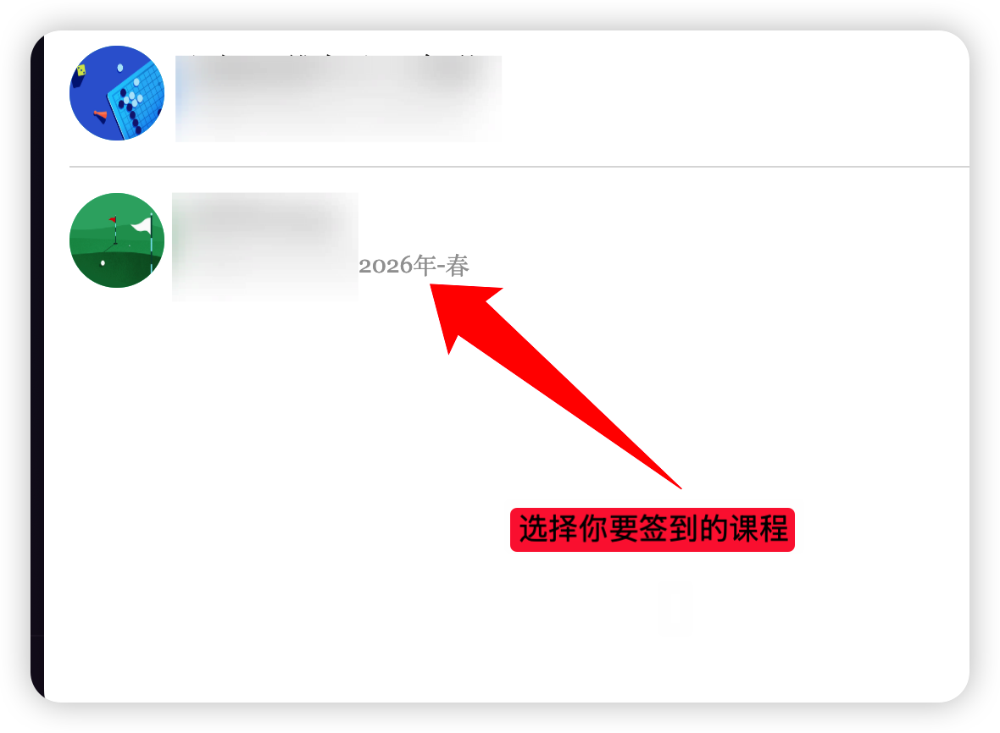
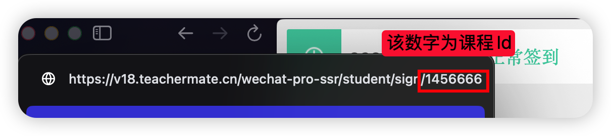
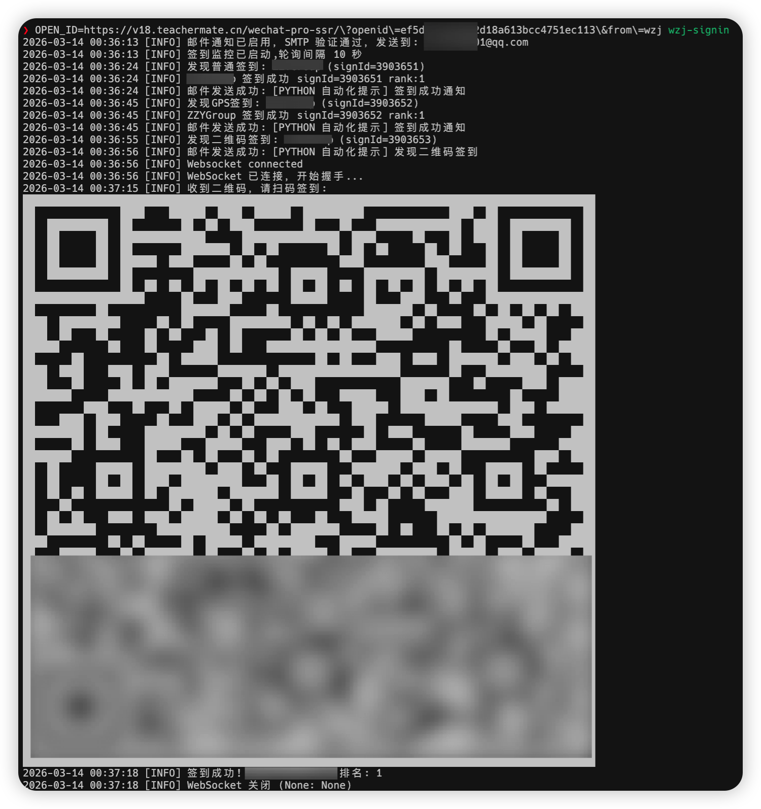
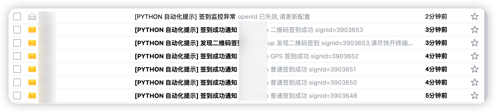

# wzj-signin

A command-line sign-in tool for TeacherMate (WeZhiJiao). This README describes the current source checkout; published PyPI releases may not include these changes.

English | [中文](README.zh-CN.md)

## Features and requirements

- **Normal sign-in:** wait a random 8–10 seconds after detecting a task, then submit.
- **GPS sign-in:** select a configured location on every startup. Apply coordinate jitter once and reuse the result for this run; submission also waits 8–10 seconds.
- **QR sign-in:** connect over WebSocket and display a compact terminal QR code for manual scanning. Match the configured student number against server success events.
- **Multiple courses:** process the account's active-sign list sequentially, without filtering it to the configured course ID.
- **OpenID checks and renewal:** validate on startup and pause for replacement credentials when the API explicitly rejects them during monitoring.
- **Asynchronous mail:** enqueue notifications and continue sign-in without waiting for SMTP.

Requires **Python 3.11+**, network access to the TeacherMate API and WebSocket, and an interactive terminal with standard input. Location selection is mandatory even when only normal sign-ins are expected. Direct `nohup`, terminal-less cron, and systemd service execution are not supported by the current interactive startup. Use interactive SSH, tmux, or screen for remote operation.

> The current normal/GPS path has a duplicate-submission issue. Read [Known limitations and issues](#known-limitations-and-issues) before real use.

## Quick start

Run commands from the project root. Do not overwrite existing configuration; credentials on the current server have already been migrated to the local secrets file.

### 1. Install dependencies

With [uv](https://docs.astral.sh/uv/):

```bash
uv sync
```

### 2. Create configuration on a new installation

Copy templates only when setting up a new environment. `-n` prevents overwriting existing files:

```bash
cp -n config.toml.example config.toml
cp -n config.secrets.toml.example config.secrets.toml
chmod 600 config.secrets.toml
```

Edit locations in the shared file and credentials in the secrets file. Both files are read from the **current working directory**, not the executable's directory.

### 3. Start

```bash
.venv/bin/wzj-signin
```

The existing script and module entry point are alternatives:

```bash
sh run.sh
# Or use the module entry point.
.venv/bin/python -m wzj_signin
```

After OpenID validation, enter a valid location number and confirm the selected name before polling begins. OpenID prompts hide input. Press `Ctrl+C` to stop.

## Configuration layout

| File | Contents | Git policy |
| --- | --- | --- |
| `config.toml` | Polling, request timeouts, locations, mail enable flag and SMTP host | Shared configuration; suitable for committing |
| `config.secrets.toml` | OpenID, course identifier, student number, sender, authorization code and receiver | Ignored by `.gitignore`; local only |
| `config.toml.example` | Shared-settings template | Safe to commit |
| `config.secrets.toml.example` | Placeholder credentials template | Safe to commit only with placeholders |

### Shared settings: `config.toml`

```toml
[default]
pollInterval = 10
connectTimeout = 5
readTimeout = 15
requestRetries = 2
retryBackoff = 1.0
# Optional API base URL override.
# apiBaseUrl = "https://v18.teachermate.cn"

[[locations]]
name = "Example location"
lon = 113.999877
lat = 22.595876

[email]
enable_send_email = false
smtp_server = "smtp.qq.com"
```

- Add one `[[locations]]` entry per location, with `name`, `lon`, and `lat`. File order determines menu numbering.
- At least one location is required. Invalid numbers prompt again; there is no implicit default.
- Selection applies an independent random offset within ±0.0001 degrees to each coordinate and formats it to six decimal places. The run reuses this pair.
- Legacy `gps_lon`, `gps_lat`, `GPS_LON`, and `GPS_LAT` settings are no longer read.
- `pollInterval` is the delay after processing a batch, not a fixed polling cadence. Sign-in delays, requests, and QR waiting add to it.

Location names and coordinates become public with this file. Do not commit locations you want to keep private. Do not move account credentials back here: those fields are read only from the secrets file or environment.

### Local credentials: `config.secrets.toml`

```toml
[default]
openId = "your_open_id_or_full_url"
courseId = "your_course_id"
studentId = "your_student_id"

[email]
sender = "your@qq.com"
password = "your_smtp_authorization_code"
receiver = "notify@example.com"
```

- `openId` accepts a raw value or a full TeacherMate URL containing an `openid` query parameter. An empty value falls back to `OPEN_ID`, then to an interactive prompt.
- `courseId` is still required at startup, but submissions use each active task's course ID. This setting is not a monitoring whitelist.
- `studentId` is the student number used to recognize QR success, not the OpenID.
- Mail credentials may be omitted while mail is disabled. Enabled mail requires `sender`, `password`, and `receiver`.
- For QQ Mail, enable SMTP and use its SMTP authorization code rather than the regular account password.

### Precedence and environment variables

**OpenID is the exception:** a nonempty saved `openId` takes priority over `OPEN_ID`. For other fields below, nonempty environment values override their respective file values. The mail-enable variable overrides the file whenever present, including `false`, `0`, and an empty string.

| Environment variable | File field | Default or requirement |
| --- | --- | --- |
| `OPEN_ID` | Secrets `[default].openId` | Raw value or full URL; prompt when missing |
| `COURSE_ID` | Secrets `[default].courseId` | Required |
| `STUDENT_ID` | Secrets `[default].studentId` | Needed for QR success matching |
| `POLL_INTERVAL` | Shared `[default].pollInterval` | `10` seconds |
| `CONNECT_TIMEOUT` | Shared `[default].connectTimeout` | `5` seconds; positive |
| `READ_TIMEOUT` | Shared `[default].readTimeout` | `15` seconds; positive |
| `REQUEST_RETRIES` | Shared `[default].requestRetries` | `2`; connection-stage retries only |
| `RETRY_BACKOFF` | Shared `[default].retryBackoff` | `1.0`; nonnegative |
| `API_BASE_URL` | Shared `[default].apiBaseUrl` | Explicit API base override |
| `ENABLE_SEND_EMAIL` | Shared `[email].enable_send_email` | `true` / `1` enables; other values disable; absent uses file |
| `SMTP_SERVER` | Shared `[email].smtp_server` | `smtp.qq.com`; port fixed at `465` |
| `EMAIL_SENDER` | Secrets `[email].sender` | Sender address |
| `EMAIL_PASSWORD` | Secrets `[email].password` | SMTP authorization code |
| `EMAIL_RECEIVER` | Secrets `[email].receiver` | One receiver address |

Without an explicit API override, a full OpenID URL supplies the API origin. An initial raw OpenID uses `https://v18.teachermate.cn`. Renewing with a raw value keeps the current API origin; a full URL may change it. Explicit API settings always take priority.

Disable mail for a run without editing files:

```bash
ENABLE_SEND_EMAIL=false .venv/bin/wzj-signin
```

Environment-only credentials still require locations in the shared configuration. There is no environment variable for choosing a location.

## OpenID validation and recovery

Startup validation uses the read-only `GET /wechat-api/v1/class-attendance/student/active_signs` endpoint, not a sign-in submission. An empty list means valid credentials with no active tasks.

- **HTTP 401 or explicit invalid/expired OpenID or login text:** request a replacement raw value or full URL and validate it before starting or resuming monitoring.
- **Timeouts, network errors, and HTTP 5xx:** keep credentials and retry at the configured interval without requesting a replacement.
- **Other or unknown responses:** log a request/API error; do not infer expiration from guessed numeric error codes.

Renewal updates both the request configuration and the Session OpenID header. Replacement values stay in memory and are never automatically written to either file. To persist a change across restarts, edit the local secrets file manually. Logs avoid full OpenIDs, student numbers, and SMTP authorization codes; inspect logs and screenshots before sharing them anyway.

## QR sign-in and email notifications

### QR sign-in

After detecting a QR task, the program enqueues an email without blocking, then immediately starts the connection to `wss://www.teachermate.com.cn/faye`. A pushed `qrUrl` is rendered directly in the terminal; no QR image attachment is mailed.

Keep the terminal visible and scan through a TeacherMate-supported flow. The program confirms your QR sign-in only when a server event matches the configured student number. It stays in that QR workflow until success or connection closure.

### Asynchronous mail

Importing the mail module does not connect to or validate SMTP. The first eligible notification starts one daemon worker, which drains `queue.Queue(maxsize=32)` serially. Capacity counts waiting messages, excluding the message currently being processed.

| Log marker | Meaning |
| --- | --- |
| `Email notification queued` | Accepted into the queue, not yet a delivery confirmation |
| `Email SMTP connecting` / `authenticating` / `sending` | Worker connection, authentication and send stages |
| `Email delivery succeeded (SMTP accepted)` | Accepted by SMTP, not a guarantee of inbox delivery |
| `Email delivery failed during ...` | This message failed; later mail and sign-in can continue |
| `Email queue full` | This notification was not enqueued |

SMTP_SSL uses `timeout=10` per socket operation, not as a whole-message deadline; total delivery can exceed 10 seconds. Failed messages and full-queue notifications are not retried automatically. The queue is not persistent: in-flight or waiting mail may be lost on process exit. SMTP cleanup failure does not invalidate a message already accepted by the server.

Notifications cover QR discovery, sign-in success, the missing-GPS-coordinates failure branch, and OpenID expiration during monitoring. Not every API or WebSocket error produces mail.

## Obtaining account information

<details>
<summary>Get OpenID</summary>

1. Open “All (A)” in the TeacherMate WeChat service account.

   

2. Copy the full page URL.

   
   

3. Put the full URL or the value after `openid=` into local `config.secrets.toml`, or enter it when prompted for renewal.

   ```text
   https://v18.teachermate.cn/wechat-pro-ssr/?openid=your_open_id&from=wzj
   ```

Do not publish the full URL in issues, commits, or screenshots.

</details>

<details>
<summary>Get course ID</summary>

1. Open the course page and browser developer tools.

   
   

2. Locate a course-related API request in Network and inspect `courseId`.

   
   
   
   

3. Save it as `[default].courseId` in the local secrets file.

</details>

## Troubleshooting and limitations

| Symptom | Check |
| --- | --- |
| `Missing COURSE_ID` | Set secrets `courseId` or `COURSE_ID` |
| `No locations configured` | Check the working directory and shared `[[locations]]` entries |
| `Interactive terminal required` | Provide terminal-backed standard input rather than a detached background launch |
| WebSocket connected but no QR | Wait for a QR push, verify the task is still active, and inspect WebSocket errors; queued mail does not prove QR reception |
| Still waiting after scanning | Ensure the configured student number matches the event's `studentNumber` |
| Mail accepted but absent from inbox | Check spam, receiver address and mailbox delivery rules |
| API connectivity problems | HTTP ignores environment proxies and WebSocket bypasses them too; do not rely on `HTTPS_PROXY` |

## Development checks

Run the existing unittest suite:

```bash
.venv/bin/python -B -m unittest discover -s tests -v
```

Tests use simulated responses and SMTP, without sending real mail or performing real course sign-ins. Passing tests do not verify the external API, actual scanning, or final mail delivery.

## Screenshots

Existing screenshots illustrate operation and notifications; current terminal rendering and logs may differ.




## References and license

- [zn-cn/wzj-sign-in-weixin](https://github.com/zn-cn/wzj-sign-in-weixin)
- [MIT License](LICENSE)
