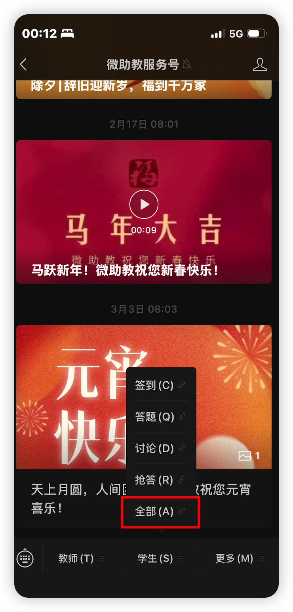
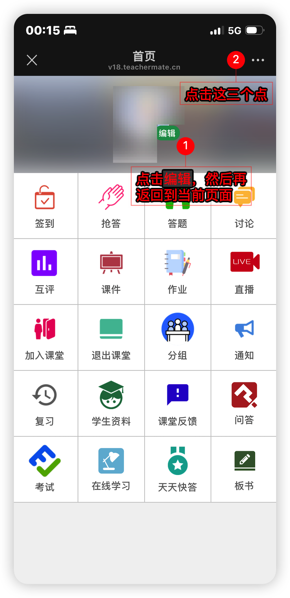
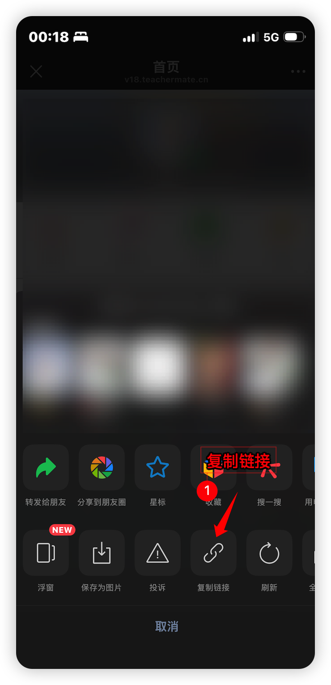
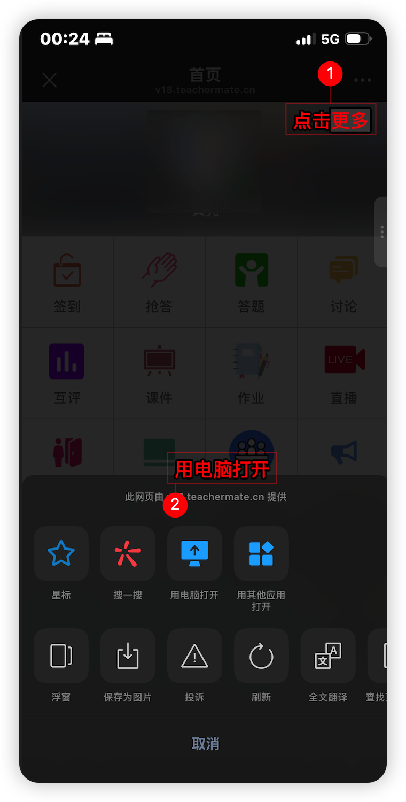
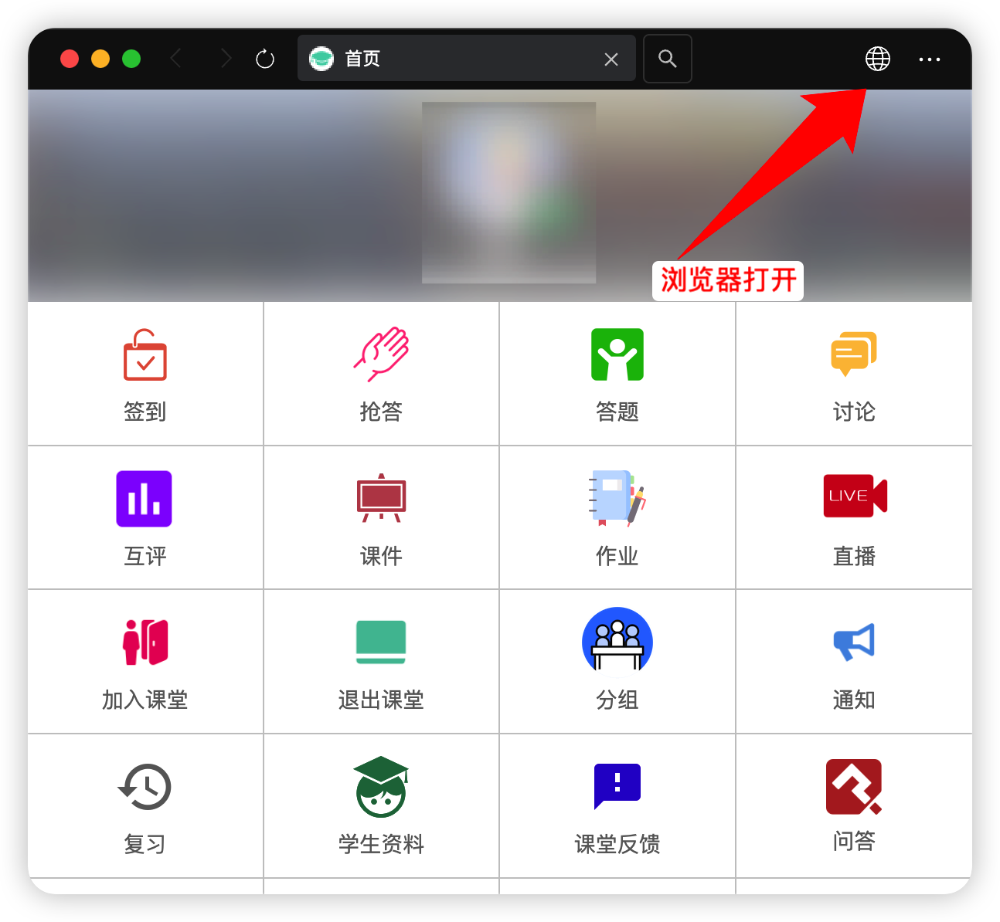
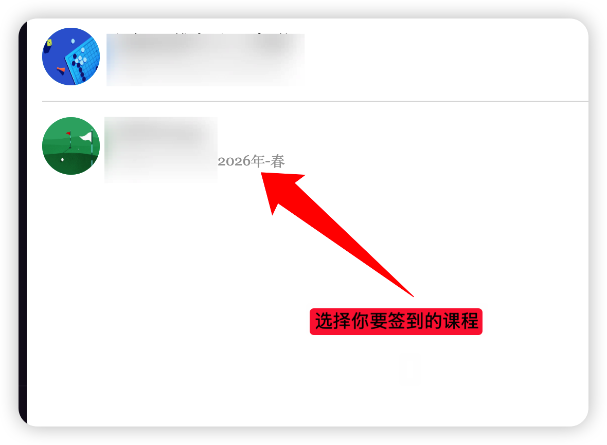
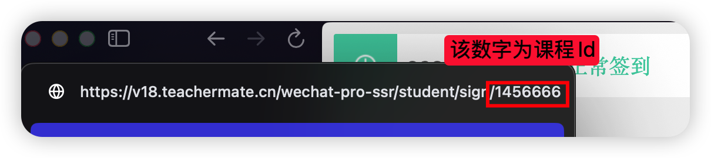
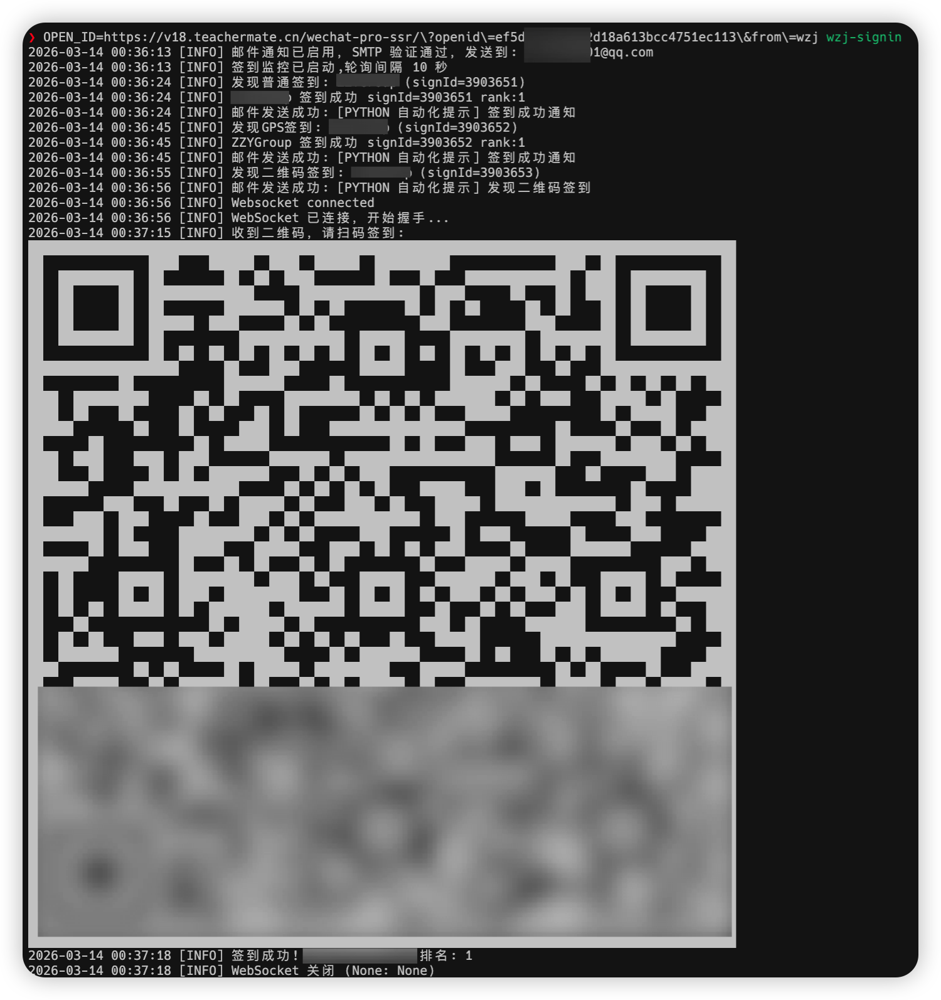

# wzj-signin

微助教命令行签到工具。本文描述当前源码实现；PyPI 上的已发布版本不保证包含相同改动。

[English](README.md) | 中文

## 功能与运行要求

- **普通签到**：检测到任务后随机等待 8–10 秒，再提交签到。
- **GPS 签到**：每次启动选择一个配置地点，坐标经过一次随机微调后用于本次运行；提交前同样等待 8–10 秒。
- **二维码签到**：连接 WebSocket，在终端以紧凑形式显示二维码，由用户扫码；根据配置的学号识别签到成功事件。
- **多课程任务**：依次处理当前账号的活动签到列表，不按配置中的单个课程 ID 过滤。
- **OpenID 检查与更新**：启动时验证；运行中明确失效时暂停并提示重新输入。
- **异步邮件**：通知入队后继续签到，不等待 SMTP 连接或发送。

需要 **Python 3.11+**、可访问微助教 API/WebSocket 的网络，以及带标准输入的交互终端。即使本次只有普通签到，启动时也必须选择地点。当前实现不适合直接使用 `nohup`、无终端的 cron 或 systemd 服务运行；远程运行可使用带交互终端的 SSH、tmux 或 screen。

> 当前普通/GPS 路径存在重复提交问题，真实使用前请阅读[已知限制与问题](#已知限制与问题)。

## 快速开始

在项目根目录执行。已有配置不要覆盖；当前服务器的凭据已迁移到本地敏感配置文件。

### 1. 安装依赖

使用 [uv](https://docs.astral.sh/uv/)：

```bash
uv sync
```

### 2. 首次创建配置

仅新环境需要复制模板；`-n` 避免覆盖已有文件：

```bash
cp -n config.toml.example config.toml
cp -n config.secrets.toml.example config.secrets.toml
chmod 600 config.secrets.toml
```

编辑普通配置中的地点，并在敏感配置中填写凭据。两个文件都从**当前工作目录**读取，不是从可执行文件所在目录读取。

### 3. 启动

```bash
.venv/bin/wzj-signin
```

也可以运行现有启动脚本或模块入口：

```bash
sh run.sh
# Or use the module entry point.
.venv/bin/python -m wzj_signin
```

程序验证 OpenID 后显示地点列表。输入有效编号，确认选中地点，再进入签到轮询。OpenID 输入使用隐藏回显；按 `Ctrl+C` 可停止程序。

## 配置文件分工

| 文件 | 内容 | Git 策略 |
| --- | --- | --- |
| `config.toml` | 轮询、请求超时、地点、邮件开关和 SMTP 服务器 | 普通配置，可提交到 GitHub |
| `config.secrets.toml` | OpenID、课程标识、学号、发件邮箱、授权码、收件邮箱 | `.gitignore` 忽略，仅保留本地 |
| `config.toml.example` | 普通配置模板 | 可提交 |
| `config.secrets.toml.example` | 仅含占位符的凭据模板 | 可提交，不能填入真实凭据 |

### 普通配置：`config.toml`

```toml
[default]
pollInterval = 10
connectTimeout = 5
readTimeout = 15
requestRetries = 2
retryBackoff = 1.0
# Optional API base URL override.
# apiBaseUrl = "https://v18.teachermate.cn"

[[locations]]
name = "Example location"
lon = 113.999877
lat = 22.595876

[email]
enable_send_email = false
smtp_server = "smtp.qq.com"
```

- 每个地点使用一个独立的 `[[locations]]`，包含 `name`、`lon`、`lat`；编号顺序与文件顺序一致。
- 至少配置一个地点。非法编号会重新提示，不会隐式选择默认地点。
- 坐标在选中时各自增加 ±0.0001 度范围内的随机偏移，并格式化为六位小数；本次运行复用该结果。
- 不再读取旧的 `gps_lon`、`gps_lat`、`GPS_LON` 或 `GPS_LAT`。
- `pollInterval` 是每批处理结束后的等待时间，不是严格的固定轮询周期；签到等待、请求和扫码时间会额外计入。

地点名称与经纬度也会随普通配置公开；不希望公开的地点不要提交。不要把账号凭据移回普通配置，程序只从敏感配置或环境变量读取这些字段。

### 敏感配置：`config.secrets.toml`

```toml
[default]
openId = "your_open_id_or_full_url"
courseId = "your_course_id"
studentId = "your_student_id"

[email]
sender = "your@qq.com"
password = "your_smtp_authorization_code"
receiver = "notify@example.com"
```

- `openId` 支持独立值或带 `openid` 查询参数的完整微助教 URL；留空时尝试 `OPEN_ID`，仍缺失则在终端询问。
- `courseId` 当前仍是启动必填字段，但实际提交使用活动签到列表中各任务的 `courseId`，不是监控课程白名单。
- `studentId` 应填写真实学号，用于二维码成功事件匹配；它不是 OpenID。
- 邮件关闭时可以不填写邮箱凭据；启用时需要 `sender`、`password`、`receiver` 都完整。
- QQ 邮箱需要先开启 SMTP 服务，并使用 SMTP 授权码，而非普通登录密码。

### 优先级与环境变量

**OpenID 是例外**：敏感文件中非空的 `openId` 优先于 `OPEN_ID`。其他下表字段使用非空环境变量覆盖对应文件值；邮件开关只要环境变量存在就覆盖文件，包括 `false`、`0` 和空字符串。

| 环境变量 | 文件字段 | 缺省值或要求 |
| --- | --- | --- |
| `OPEN_ID` | 敏感配置 `[default].openId` | 支持完整 URL；缺失时交互输入 |
| `COURSE_ID` | 敏感配置 `[default].courseId` | 必填 |
| `STUDENT_ID` | 敏感配置 `[default].studentId` | 二维码成功识别需要 |
| `POLL_INTERVAL` | 普通配置 `[default].pollInterval` | `10` 秒 |
| `CONNECT_TIMEOUT` | 普通配置 `[default].connectTimeout` | `5` 秒，必须大于 0 |
| `READ_TIMEOUT` | 普通配置 `[default].readTimeout` | `15` 秒，必须大于 0 |
| `REQUEST_RETRIES` | 普通配置 `[default].requestRetries` | `2`，仅连接阶段重试 |
| `RETRY_BACKOFF` | 普通配置 `[default].retryBackoff` | `1.0`，不能为负 |
| `API_BASE_URL` | 普通配置 `[default].apiBaseUrl` | 显式覆盖 API 基础地址 |
| `ENABLE_SEND_EMAIL` | 普通配置 `[email].enable_send_email` | `true` / `1` 启用，其他值关闭；未设置时使用文件值 |
| `SMTP_SERVER` | 普通配置 `[email].smtp_server` | `smtp.qq.com`，端口固定为 `465` |
| `EMAIL_SENDER` | 敏感配置 `[email].sender` | 发件邮箱 |
| `EMAIL_PASSWORD` | 敏感配置 `[email].password` | SMTP 授权码 |
| `EMAIL_RECEIVER` | 敏感配置 `[email].receiver` | 单个收件邮箱 |

没有显式 API 地址时，完整 OpenID URL 会提供 API 域名；独立 OpenID 初次使用默认地址 `https://v18.teachermate.cn`。更新时输入独立 OpenID 会保留当前 API 地址，输入完整 URL 则可更新域名，显式 API 配置始终优先。

临时关闭邮件而不修改文件：

```bash
ENABLE_SEND_EMAIL=false .venv/bin/wzj-signin
```

即使全部凭据来自环境变量，仍需要普通配置中的地点列表。地点不能用环境变量选择。

## OpenID 验证与恢复

启动时通过只读 `GET /wechat-api/v1/class-attendance/student/active_signs` 验证凭据，不通过提交签到来验证。空列表表示凭据有效、当前没有活动任务。

- **HTTP 401 或明确的 OpenID/登录失效文本**：提示输入新值，支持独立 OpenID 或完整 URL；验证通过才能开始或恢复监控。
- **超时、网络异常、HTTP 5xx**：保留凭据，按配置间隔重试，不要求更换 OpenID。
- **其他或未知响应**：作为请求/API 异常记录，不凭猜测的数字错误码认定失效。

重新输入时同步更新请求配置和 Session 的 OpenID 请求头。新值仅用于当前进程，不写回任何配置文件；需要跨重启保存时，应手动更新本地敏感配置。程序不会在日志中输出完整 OpenID、学号或 SMTP 授权码；分享日志和截图前仍应人工检查个人信息。

## 二维码与邮件通知

### 二维码

发现二维码任务后，程序先非阻塞地提交邮件通知，再立即启动 `wss://www.teachermate.com.cn/faye` 连接。接收 `qrUrl` 后直接在终端渲染二维码，不发送二维码图片附件。

保持终端可见并使用微助教支持的扫码方式完成签到。只有服务端推送的学号与配置匹配，程序才确认本人的二维码签到成功。等待期间保持当前二维码处理流程，直到成功或连接关闭。

### 异步邮件

邮件模块导入时不连接或验证 SMTP。第一次有效通知启动一个后台守护线程，使用 `queue.Queue(maxsize=32)` 串行发送；队列容量是等待邮件数，不含正在处理的一封。

| 日志标记 | 含义 |
| --- | --- |
| `Email notification queued` | 已入队，不代表已发出 |
| `Email SMTP connecting` / `authenticating` / `sending` | 工作线程的连接、认证、发送阶段 |
| `Email delivery succeeded (SMTP accepted)` | SMTP 已接受邮件，不保证进入收件箱 |
| `Email delivery failed during ...` | 该封发送失败，不影响后续邮件或签到 |
| `Email queue full` | 队列已满，本次通知未入队 |

SMTP_SSL 使用 `timeout=10`，限制各项 socket 操作，不是总耗时上限；整封邮件仍可能耗时超过 10 秒。失败邮件和队列满时的通知不会自动重试。队列不持久化，进程退出时正在发送或等待的邮件可能丢失；SMTP 退出清理失败不会否定已经被接受的邮件。

通知包括发现二维码、签到成功、缺少 GPS 坐标的失败分支，以及运行中 OpenID 失效；并非所有 API 或 WebSocket 错误都会发送邮件。

## 获取账号信息

<details>
<summary>获取 OpenID</summary>

1. 在微助教微信服务号中进入「全部(A)」。

   

2. 复制打开页面的完整链接。

   
   

3. 将完整链接或 `openid=` 后的值填写到本地 `config.secrets.toml`，也可在失效提示时输入。

   ```text
   https://v18.teachermate.cn/wechat-pro-ssr/?openid=your_open_id&from=wzj
   ```

不要把完整链接发到公开 issue、提交记录或截图中。

</details>

<details>
<summary>获取课程 ID</summary>

1. 打开微助教课程页面和浏览器开发者工具。

   
   

2. 在 Network 中找到课程相关 API 请求，查看 `courseId`。

   
   
   
   

3. 填入本地敏感配置的 `[default].courseId`。

</details>

## 排查与已知限制

| 现象 | 检查事项 |
| --- | --- |
| `Missing COURSE_ID` | 填写敏感配置的 `courseId` 或设置 `COURSE_ID` |
| `No locations configured` | 检查当前工作目录及普通配置中的 `[[locations]]` |
| `Interactive terminal required` | 使用有标准输入终端的方式运行，不要直接后台脱离终端 |
| 已连接 WebSocket，但没有二维码 | 等待二维码推送；确认任务仍有效，检查 WebSocket 错误，不把邮件入队日志当作二维码接收成功 |
| 扫码后仍等待 | 检查配置学号是否与服务端返回的 `studentNumber` 一致 |
| 邮件显示成功但未收到 | 该日志只证明 SMTP 接受；检查垃圾邮件、收件地址和邮箱投递规则 |
| API 连通性异常 | HTTP 请求禁用环境代理，WebSocket 也绕过代理；不要依赖 `HTTPS_PROXY` 自动生效 |

## 开发检查

运行现有 unittest 测试集：

```bash
.venv/bin/python -B -m unittest discover -s tests -v
```

测试使用模拟响应与 SMTP，不发送真实邮件，不执行真实课程签到；通过测试不等于已验证服务端接口、扫码或最终邮件投递。

## 截图

以下为已有运行与邮件示意，具体终端样式和日志以当前实现为准。




## 参考与许可证

- [zn-cn/wzj-sign-in-weixin](https://github.com/zn-cn/wzj-sign-in-weixin)
- [MIT License](LICENSE)
